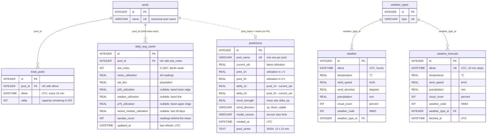

# Database Schema

SQLite database stored in a Docker volume (`db_data`), which is mounted to the host system at `/var/lib/docker/volumes/swm_pool_utility_db_data/_data`. Inside the containers the file is `/data/swm_pool_utility.db`.

A fresh database is created by the one-shot `db-init` service in [`docker-compose.yml`](docker-compose.yml). That command is the source of truth for the schema of a new install. Existing databases are brought up to date with the scripts in [`migrations/`](#migrations).

## Entity-relationship diagram



`pools` and `weather_types` are lookup tables. The dashed line is a logical link only: `predictions.pool_name` holds the pool's name as text and has no foreign key.

## Conventions

- **Timestamps** are stored as UTC text in the form `YYYY-MM-DD HH:MM:SS`. The writers set them explicitly; conversion to Europe/Berlin happens at read time in the API and the aggregator. The one exception is `daily_avg_cache.slot_index`, which is computed in Berlin wall-clock time.
- **`utility` vs. utilization.** `track_pools.utility` stores what SWM reports: *capacity remaining*, where 100 means empty or closed. Every derived value (`daily_avg_cache.*_utilization`, all `predictions` columns) is *utilization*, `100 − utility`, where 100 means full.
- **Closed pools** are stored as `utility = 100`. Some pools report 0 when closed; the scraper maps that to 100 before inserting.
- **Pool names** are normalised to one canonical spelling by the scraper (migration 007), because `predictions` and the API match pools by name. The canonical form folds the typographic apostrophes ‘ and ’ to a plain `'`, and the stored names use that form (migration 020), e.g. `Müller'sches Volksbad`.

## Table notes

**track_pools**
- `UNIQUE(pool_id, dtime)` (index `idx_track_pools_pool_dtime`) enforces one reading per pool per second. Inserts use `ON CONFLICT ... DO NOTHING`, so the first write for a given second wins and later duplicates are skipped.
- The scraper deletes rows in two cases. When SWM marks a pool as closed long-term, its `utility = 100` rows from the last 30 days are deleted. When a pool reads busy again right after a short run (at most 2 readings) of "closed" values, that run is deleted as a false-empty glitch.
- **Data caveat:** since 2026-09-22 SWM books arrivals once an hour (in the reading between :10 and :20) while departures are still counted live. Curves after that date look like a saw blade. This comes from SWM's data, not from the scraper.

**daily_avg_cache**
- One row per pool and 10-minute slot of the week: `slot_index` 0 is Monday 00:00, 1007 is Sunday 23:50 (Berlin time). `UNIQUE(pool_id, slot_index)` is the upsert key (`ON CONFLICT(pool_id, slot_index) DO UPDATE`).
- `mean_utilization` and `std_dev` use all readings. The mean feeds the ML feature `avg_weekday_delta`.
- `p25_`, `median_` and `p75_utilization` exclude closure days and pool the readings of the slots within ±20 min (a 50-minute window). They draw the band and line of the Daily Statistics view.
- `recent_median_utilization` is the same median over the 28 full days before today (Berlin time) only. It draws the "lately typical" line in the single-pool live chart.
- The four percentile/median columns stay NULL when every reading in the window fell on a closure.

**predictions**
- Holds only the latest prediction per pool. Each run replaces the pool's row with `INSERT OR REPLACE`, so there is no history and `id` changes on every write.
- `delta_*` are in percentage points. `trend_strength` is `(|delta_1h| + |delta_2h|) / 2`. `trend_direction` is "up" or "down" when `delta_1h` exceeds ±2 pp, otherwise "stable".
- `model_version` is the start time of the prediction service (`YYYYMMDDHHMMSS`), not the training time.

**weather_types, weather, weather_forecast**
- `weather_types` is seeded by `db-init` in this order: clear (1), partly_cloudy (2), foggy (3), rain (4), snow (5), thunderstorm (6), unknown (7). `weather_type_id` is derived from the WMO `weather_code`.
- Open-Meteo returns hourly forecast values. The forecast scraper interpolates temperature, wind, precipitation and cloud cover linearly to 10-minute steps; `weather_code` is taken from the hour the step falls in. Rows are written with `INSERT OR REPLACE`, so each run overwrites the steps it covers, and rows older than 8 days are deleted at the start of every run.

## Indexes

| Index | Table | Columns | Purpose |
|-------|-------|---------|---------|
| `idx_track_pools_pool_dtime` | track_pools | `(pool_id, dtime)` UNIQUE | One reading per pool per second (migration 015) |
| `idx_track_pools_pool_id_dtime` | track_pools | `(pool_id, dtime, utility)` | Covering index for per-pool time-range queries (migrations 006/007) |
| `idx_track_pools_dtime` | track_pools | `(dtime)` | Time-range queries across all pools |
| `idx_weather_dtime` | weather | `(dtime)` | Time-range queries |
| `idx_weather_forecast_dtime` | weather_forecast | `(dtime)` UNIQUE | One forecast point per timestamp, the conflict target of `INSERT OR REPLACE` |
| *(auto)* | pools, weather_types, daily_avg_cache, predictions | UNIQUE constraints | Created by SQLite for the `UNIQUE` columns above |

## Writers and readers

| Table | Written by | Write mode | Cadence | Read by |
|-------|------------|------------|---------|---------|
| pools | pool-scraper | `INSERT OR IGNORE` on first sight | as needed | api, daily-stats, ml-prediction, ml-training |
| weather_types | db-init | seeded once | once | weather-scraper, weather-forecast-scraper, api |
| track_pools | pool-scraper | `INSERT ... ON CONFLICT DO NOTHING`, plus the deletes above | every 10 min | api, daily-stats, ml-prediction, ml-training |
| weather | weather-scraper (Open-Meteo current conditions) | `INSERT` | hourly | api, ml-training |
| weather_forecast | weather-forecast-scraper (Open-Meteo, 7 days) | `INSERT OR REPLACE`, rows older than 8 days deleted | hourly | ml-prediction |
| daily_avg_cache | daily-stats | full rebuild, upsert per `(pool_id, slot_index)` | hourly | api, ml-prediction, ml-training |
| predictions | ml-prediction | `INSERT OR REPLACE` per pool | every 10 min | api |

ml-training writes its models to the `model_data` volume, not to the database.

## Maintenance

- **`PRAGMA auto_vacuum = INCREMENTAL`** is set by `db-init` (migration 005 converts older databases).
- **Full `VACUUM`** runs once a week, Sundays at 03:00 UTC, from the weather-forecast-scraper.
- **No retention policy.** `track_pools` and `weather` keep their full history. The former db-cleanup service was removed on purpose (migration 002). Only `weather_forecast` is pruned.
- `sqlite_sequence` is SQLite's internal table for the `AUTOINCREMENT` counters.

## Migrations

Schema and data changes are applied as numbered migration scripts in `migrations/`. Each script is idempotent (safe to run more than once) and follows the same pattern:

1. Stop running services
2. Apply schema changes via a Python or SQLite session inside a container
3. Restart services

```bash
docker compose build
bash migrations/<NNN>_<name>.sh            # apply
bash migrations/<NNN>_<name>.sh --dry-run  # preview only (013 and later)
```

Flags differ between scripts: 007–011 expect `--up`, 001 `--rebuild`, and 014 also takes `--days N`. The usage block at the top of each script lists its flags.

| # | Kind | Change |
|---|------|--------|
| 001 | data | Rebuild `daily_avg_cache` with Berlin-time slots instead of UTC |
| 002 | — | No-op: records the deliberate removal of the db-cleanup service |
| 003 | schema | Replace `predictions` with the trend schema |
| 004 | schema | Add `predictions.pred_series` |
| 005 | pragma | Enable `auto_vacuum = INCREMENTAL` |
| 006 | index | Extend the `track_pools` index to a covering index |
| 007 | schema | Normalise pool names and weather types into the `pools` / `weather_types` lookup tables |
| 008–011 | data | Fix closed-state utility (0 → 100) for Freibäder, Michaelibad, Südbad, Volksbad; remove ghost pools |
| 012 | data | Backfill missing weather history |
| 013 | data | Normalise utility during closed hours |
| 014 | data | Backfill confirmed closed-hours gaps at night |
| 015 | index | Add `UNIQUE(pool_id, dtime)` to `track_pools` |
| 016 | data | Remove site-wide-glitch 0% samples |
| 017 | data | Remove false-empty ("closed") glitch samples |
| 018 | schema | Add `p25_`, `median_`, `p75_utilization` to `daily_avg_cache` |
| 019 | schema | Add `recent_median_utilization` to `daily_avg_cache` |
| 020 | data | Merge pools whose names differ only in apostrophes (the split `Müller'sches` / `Müller’sches Volksbad`) and store the canonical spelling |
